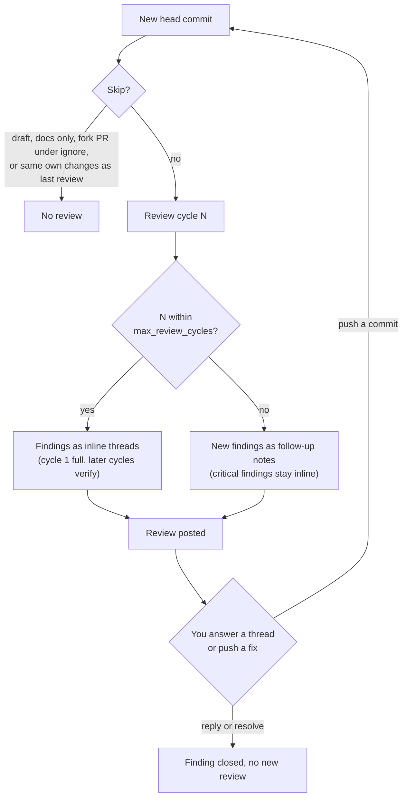

# How a review works

How pr-reviewer decides what to review, what to post and what to keep quiet about. If you wrote a pull request and want to act on a review, see [Respond to a review](../how-to/respond-to-a-review.md). For the keys that control this, see the [configuration reference](../reference/configuration.md).

---

## What a review contains

pr-reviewer reviews a pull request in a watched repository each time its head commit changes. A **finding** is one problem that a review cycle reports. A review shows a finding in one of two ways:

- As an inline review thread on a line of the diff. A thread is a blocking finding or a warning. A blocking finding makes the review request changes.
- As a **follow-up note** in the review body. A follow-up note cannot block the merge.

The review body also holds a summary, a confidence line and a collapsed **Review metadata** section. The bot never approves a pull request.



The sections below explain each step of this diagram.

---

## Review cycles

pr-reviewer reviews every new head commit of a PR. Each posted review is one **review cycle**. Without a limit, every review cycle can add new inline findings, and each one opens a thread that someone must resolve. `max_review_cycles` stops that loop.

| Review cycle | What the bot does |
|-------|-------------------|
| 1 | Full review. The prompt asks for every finding now, because later review cycles focus on fixes. |
| 2 to `max_review_cycles` | Verification. The bot checks its earlier findings first. It reports a new finding only for code that changed since its last review, or for a real bug, security or data-integrity problem. |
| After `max_review_cycles` | Follow-up. New findings go into a **Follow-up notes (non-blocking)** section of the review body. They do not open threads and cannot request changes. |

A **critical finding** is the exception. After the limit it is still posted inline, and it can request changes. A finding is critical when all three are true:

- its severity is `blocking`,
- its `finding_kind` is in `critical_finding_kinds`,
- it has an `evidence_note` that names the changed lines.

After the limit, a critical finding must also sit on a line the PR adds or removes. A critical finding elsewhere is listed first in the notes, as a "possible blocker". The default `critical_finding_kinds` includes `correctness`, so a proven blocking bug in changed code can still stop a merge in any review cycle. To bound blocking findings too, remove `correctness` from the list. The cost of the changed-line rule: after the limit, a break in a file the PR did not touch, such as a caller of a changed function, is only a note.

A review cycle is one reviewed commit. The bot counts its earlier reviews on GitHub, so the count survives a reset of its database. If GitHub does not return the list of reviews, the bot tries once more and then fails the review. It does not guess the review cycle.

The bot also does not repeat itself:

- If a new finding matches one of its threads that is still open, the bot does not post it again. The finding stays open, and a blocking one still counts as blocking. If that is all the bot has to say, it posts no review: the thread and the earlier change request still stand.
- If a human resolved the thread, the finding is dropped. A critical finding opens it again only when this PR's change to that file is different from the last review.
- A follow-up note is not repeated in later review cycles.
- A stored finding is marked fixed only when this PR's change to its file is different from the last review, or the file left the diff. A push that leaves the file's change as it was cannot fix it. If that is unknown, for example on the first review after an upgrade, the finding stays open. A human who resolves its thread closes it.

Two findings match when they are in the same file and share most of their meaningful words. If both quote code identifiers in backticks, they must share one, so the same sentence about `delete_user` and about `update_user` stays two findings. To hide a new finding as "still open" or "resolved", the match must also be within 15 lines. For a thread whose lines a later push changed, GitHub reports no current line; the bot then uses the line the comment was first posted on, and a thread with no known line hides nothing. The same rule decides which findings a reply in a review thread, such as "this is intentional", covers, so the reply does not hide unrelated findings in the same file. A comment in the PR conversation that puts a topic out of scope ("not in this PR") is broader: it hides findings on that topic in any file, unless the finding has an `evidence_note`. Critical findings always have one, so they are never hidden this way.

The bot never approves a PR. So its `REQUEST_CHANGES` review would stay on the PR after the findings are fixed. With `dismiss_stale_change_requests`, the bot dismisses its own earlier change requests when no blocking finding is open in its records, after a posted review or after a review with nothing new. If it has no records for the PR, it leaves the change request alone.

A fix can land in a file other than the one the finding is on, for example when the author regenerates code. The finding then stays open, because its own file did not change. To close it, resolve its thread, or answer that it is intentional or out of scope. Resolving a thread does not trigger a review, so while a reviewed PR has a blocking finding open, the daemon reads its review threads at most every 2 minutes. When a human answered every open blocking finding, the daemon records the answers and dismisses the change request. It does not run a review to do this. While the head is not yet reviewed, the daemon leaves the threads to the next review.

Set `max_review_cycles = 0` to keep the old behavior: every review cycle posts every finding inline.

### A review with nothing new

When a PR already has a pr-reviewer review and a new review cycle finds nothing new to post, the bot posts no review and no comment, and the review ends as `skipped:no-novel-findings`. A merge gate that reads GitHub cannot tell this case from "not reviewed yet". With `status_on_no_new_findings` turned on, the bot also posts a commit status on the head commit: context `pr-reviewer`, state `success`, description `Reviewed: no new findings`. The setting is off by default, and a review that posts findings never posts this status, and neither does any other skip, such as `skipped:unchanged-diff`. The status says only that the head was reviewed and nothing new was found. It does not say that no blocking finding is open: an earlier change request stays in force while a blocking finding is open, so a merge gate should also read the PR's review state. If GitHub refuses the status, the bot logs a warning and the review still ends the same way. See [Configuration](../reference/configuration.md#defaults).

---

## Stacked PRs

A **stacked PR** targets the head branch of another PR instead of the default branch. Its diff shows only its own change. Stack tools such as `gh stack`, Graphite (`gt`) and git-spice rebase and force-push every PR above a PR that changed. Each upper PR then gets a new head commit, although its own change is the same.

With `skip_unchanged_diff`, pr-reviewer stores a fingerprint of each reviewed diff, once the review is on GitHub. The fingerprint covers the file paths, the added and removed lines, and the unchanged line just before and just after each group of changes. It leaves out line numbers, the other context lines and `index` lines. If a new head commit has the same fingerprint as the last reviewed one, the review is skipped (`skipped:unchanged-diff` in `pr-reviewer logs`). The skip does not use up a review cycle. These pushes keep the fingerprint:

- a rebase onto a moved base branch, for example after a change in a lower PR,
- the retarget to the default branch after the parent PR merges,
- a merge of the base branch into the PR branch.

Any change to the PR's own added or removed lines makes the bot review it again. So does moving an added line past an unchanged one, such as a guard moved after the call it guards. A diff with a file that has no text hunks (a binary file, a mode change, a file too large for a patch) cannot be compared, so it is always reviewed. The bot still records the per-file fingerprints of its text files. Use `pr-reviewer review owner/repo#N --force` to review an unchanged diff anyway.

With `stack_aware`, pr-reviewer finds the PR's place in its stack:

1. GitHub's native stack (`gh stack`) adds a `stack` object to the PR. It gives the stack number, the PR's position and the stack size.
2. For other tools, the bot follows the base branch to the open PR in the same repository whose head branch it is, and repeats this down to the default branch. PRs from forks are never used as parents.

The review prompt then names the parent PR and lists the lower PRs. It tells the reviewer to report findings only on lines this PR changes, and that a checkout of the default branch does not contain the lower PRs' changes. Open findings of the lower PRs are listed in the prompt. A new finding on a line this PR does not change, that matches one of them, is not posted on the upper PR, because the lower PR already tracks it. A finding on a line this PR changes is always this PR's own, and a critical finding is never dropped this way. Findings stay on the PR where they were raised, also after other PRs in the stack merge or rebase.

Limits:

- Stacks are found by branch name. A PR that targets a long-lived branch, such as `develop`, while an open PR merges `develop` into `main`, is treated as stacked on that PR.
- A skipped push is not reviewed against the new base. A conflict resolution that changes the PR's own lines is reviewed, but a semantic break that a lower PR causes is not. CI catches those.
- The fingerprint covers text hunks only. A change to a binary file alone does not change it.
- If a lower branch is force-pushed and the upper branch is not rebased yet, the upper PR's diff can briefly include the lower PR's commits. A review in that window sees the larger diff. `gh stack` pushes all branches at once, which keeps the window short.

---

## Fork policy

A **fork PR** has its head branch in a fork of the repository that it targets. The code in a fork PR is untrusted, so the fork policy of the repository controls what pr-reviewer does with it. As the author of a fork PR, you see no review at all under the default policy. See [Respond to a review](../how-to/respond-to-a-review.md#work-in-a-fork-pr).

| Policy | Behavior |
|--------|----------|
| `ignore` | Skip fork PRs entirely. No review is posted. (default) |
| `limited` | Review with diff only. File contents are not included to avoid executing untrusted code paths in context assembly. |
| `full` | Full context, same as a non-fork PR. Use only for forks you trust (e.g., internal org forks). |

`trusted_authors` overrides the policy for specific GitHub usernames. A trusted author's PR always gets full context regardless of `fork_policy`:

```toml
[[repos]]
owner = "your-org"
name = "your-repo"
fork_policy = "limited"
trusted_authors = ["dependabot[bot]", "known-external-contributor"]
```

---

## Confidence scoring

Review output includes a simple confidence object:

- `level`: `high`, `medium`, or `low`
- `reasons`: short machine-readable reason labels
- `justification`: a concrete explanation of what evidence is present or missing

The confidence level is shown in the posted review body. Low-confidence blocking
findings are downgraded unless they include concrete evidence, which prevents
speculative `REQUEST_CHANGES` reviews. GitHub self-review restrictions are handled
separately: when the authenticated user authored the PR, verdicts are posted as
`COMMENT` because GitHub rejects self-approval and self-request-changes reviews.

Confidence scoring is not configurable per repo today. If a repo routinely
triggers low-confidence reviews, use `custom_instructions` to give the model more
context about the domain, expected invariants, and validation patterns.
